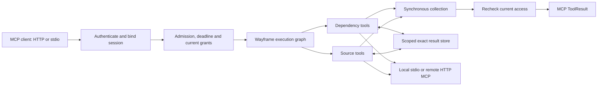

# Architecture

## MCP gateway

A direct tool call uses a compiled authorize → invoke → authorize-release graph. An authored virtual tool uses an immutable DAG compiled from configured argument bindings. Independent steps can run concurrently, previous results feed later steps, and a synchronous join collects selected outputs before release. All configured steps execute; selecting fewer output fields does not silently remove effects.

`src/config.rs` owns trusted configuration and structural validation. `src/gateway.rs` owns identities, sessions, rate limits, prewarming and reuse; `gateway/http.rs` and `gateway/stdio.rs` own ingress lifecycles. `src/upstream.rs` owns MCP negotiation, catalogs and stdio/HTTP clients. `src/workflow.rs` translates authored bindings into Wayframe graphs.

Every downstream session has separate upstream clients. Each client serializes its own connection operations; distinct servers and downstream sessions can run concurrently. Per-request admission, per-session job caps and separate prewarm admission bound active work. Operator-selected stdio principals use the same controls as HTTP users.

## Ownership

| Wayframe | Waypilot |
| --- | --- |
| Typed graph dependencies, choices and joins | Tool contracts, argument provenance and MCP workflow semantics |
| Mandatory gates and fixed execution deadlines | Identity projection and current tool/reuse authorization |
| Bounded scheduling and node timings | Prediction confidence and preparation eligibility |
| Supervised process transport | MCP initialization, HTTP/SSE parsing and session compatibility |
| Generic typed cache, TTL/byte bounds and singleflight | Scope keys, operator freshness contracts and invalidation triggers |
| Generic optional trace export | MCP-specific span fields and qualification reports |
| Future work leases and continuation primitives | Resource witnesses, agent adapters and speculative promotion policy |

The gateway consumes public crates from a pinned framework commit. No Wayframe code change was necessary for this prototype. Future extraction requires both a working Waypilot scenario and a non-agent use case.

## Validity and controls

Gateway reuse keys hash tenant, subject, grants, global generation, server ID, operator contract revision, catalog digest, tool and exact arguments. Entries have a 512-entry/16 MiB accounted payload budget, LRU eviction and TTL expiry. Accounted bytes exclude allocator/object overhead. Retained values are process-local; same-key misses use the framework's bounded singleflight guard.

Only explicit reusable-tool contracts enable retention. Authorization decisions, gates and required external effects are not retained as computation results. Every child tool checks current grants, including after waiting for connection preparation, and release rechecks the root and child grants. An administrative update changes the generation, invalidates retained results and prevents earlier-generation work from releasing results. Disabling a user additionally cancels their sessions.

The owned workflow uses immutable manifest and source content. Changing the source argument produces new keys for its two tools; unchanged dependency results remain reusable. The gateway retains each tool result individually, while the original fixture engine retains its complete two-tool branches. A derived result receives the previous tool's exact structured output as its input. This establishes exact-input incremental behavior, not generalized dependency inference or mutable-resource freshness.

A TTL bounds retention; it does not prove current external state. Session-independent behavior, hidden dependencies, selectors, tool implementations and resource versions belong in an operator's validity contract. Mutable external tools remain ineligible by default. A future dependency witness must identify an immutable resource revision, reliable change signal or explicitly accepted staleness policy.

## Prewarming and cancellation

The gateway learns per-user server-use frequency from successfully released tool results. After two observations it can prepare up to two permitted, opted-in environments on a new HTTP session. Preparation negotiates MCP, sends the initialized notification and validates the catalog. It issues no `tools/call`; initialization can still be visible to the remote service. Profiles are aggregate in-memory counts, not stored prompts, arguments or learned workflow structure.

Cancellation is local control, not rollback. An invocation owns its connection while I/O is pending. Dropping that future discards the connection; a subsequent distinct invocation can initialize afresh, while the failed call is never replayed automatically. Already-issued HTTP effects may finish at the server. Stdio cancellation invalidates that subprocess, which is why unrelated requests cannot share an active stdio exchange.

Singleflight serializes same-key eligible work; it does not create detached speculative tasks or independent consumer leases. A leader's successful retained result may satisfy a follower after current checks. Failed leaders store no result, so an authoritative follower can perform its own eligible read. General shared execution, independent cancellation ownership and speculative result promotion remain separate milestones.

See [gateway operations](gateway.md) for transport coverage, exact limits and hosting behavior.

## Retained fixture baseline

The original `Engine` in `src/runtime.rs` remains a small embedding and benchmark harness. It owns two fixture-only MCP sessions, a bounded 128-entry/4 MiB branch store, and a generation-validated exportable frequency profile. One authoritative run is admitted per engine; its two branches can execute concurrently. Its `Permit` is a test/embedding control rather than network authentication.

That harness compares serial, parallel and learned prewarming execution with the same immutable fixture outputs. It deliberately fails closed after a disconnected process and requires a new engine; the general gateway's client replacement applies to subsequent distinct gateway invocations. Both paths check access after preparation and before dispatch. Keeping the baseline makes optimization costs and behavioral regressions measurable without adding an agent or model dependency.
