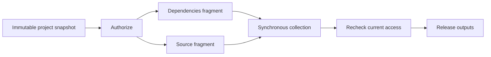

# Architecture

## Current executable slice

Each fragment first checks its exact-key result store. On a miss it invokes two MCP tools in sequence; the fragments may run concurrently. Tool inputs are immutable supplied content. The example does not read a changing repository or query a live package registry. There is no hidden mutable-resource freshness claim.

The graph is compiled once for an engine. An engine owns its cache, profile and two MCP sessions. A new configuration generation creates another engine. Cache entries are not serialized or shared across engines.

## Ownership

| Wayframe | Waypilot |
| --- | --- |
| Typed graph dependencies, choices and joins | Tool contracts, argument provenance and fragment semantics |
| Mandatory gates and fixed execution deadlines | Identity projection and current tool/reuse authorization |
| Bounded scheduling and node timings | Prediction confidence, speculative eligibility and value estimates |
| Supervised process and network boundaries | MCP initialization, catalog validation and session compatibility |
| Generic optional trace export | Agent-specific span fields and qualification reports |
| Future typed reuse and lease primitives | Resource freshness rules and invalidation sources |

## Result validity

The current cache key hashes identity scope (tenant and subject), authored contract revision, fixture implementation digest, fragment identity and exact relevant input bytes. The cache has a 128-entry and 4 MiB serialized-data budget, LRU eviction and TTL expiry. Memory allocator overhead is not included in the byte estimate. A different source input produces a new source key; the dependency key stays usable. Old versions are bounded and eventually expire or are evicted.

Successful explicitly reusable data computations may be retained. Authorization decisions, mandatory gates and required external effects are never retained as computation results. Each run checks current authorization; revocation during I/O prevents later calls and release. Already issued I/O cannot be unsent.

Later mutable-resource support needs an explicit validity witness: immutable object revision, reliable resource version/change notification, or a declared bounded-staleness policy. A TTL limits retention; it does not prove that an external value is current. A branch's dependency vector must include selectors, session state, tool versions and any hidden dependencies exposed by its contract. Unknown effects or dependencies make a candidate ineligible for automatic reordering or result reuse.

## Prediction and prewarming

The first predictor is a fixed-workload frequency baseline over successfully released fragment/server use. It needs at least two successful runs, predicts server use seen in at least half of those runs, and has only two configured roles. Profiles contain aggregate counts and a generation revision; invalid or foreign profiles are rejected. There is no natural-language intent router, learned dependency graph or trained model.

Prewarming starts the process, negotiates MCP initialization, sends the initialized notification and validates the expected tool catalog. It does not issue `tools/call`. The fixture is operator-owned; its pure behavior is an authored contract, not something inferred from a server's `readOnlyHint`.

## Cancellation and sharing boundary

Current MCP environments contain no tenant credentials or tenant state. Production session pools must be keyed by compatible credentials, tenant, server, protocol and environment revisions. Arbitrary sessions cannot be pooled across identities.

Wayframe's current stdio transport invalidates a subprocess when an outstanding response is abandoned. Waypilot therefore does not detach speculative calls or attach independent consumer leases to shared in-flight work yet. A disconnected engine fails closed and requires a new generation; it does not automatically retry a tool call. Speculative execution will initially own separate bounded environments so canceling a prediction cannot terminate an authoritative call's process.

An engine currently admits one authoritative run at a time and rejects overlapping runs. Independent branches inside that run still execute concurrently. This prevents cancellation of one run from terminating a process used by another run before independent session/consumer leases exist.

Current counters describe aggregate engine activity, including prewarming. Per-request resource accounting, robust session replacement, per-consumer cancellation and durable recovery belong to later milestones. Restarting an engine currently discards its retained results; the aggregate prediction profile is explicitly exportable.
